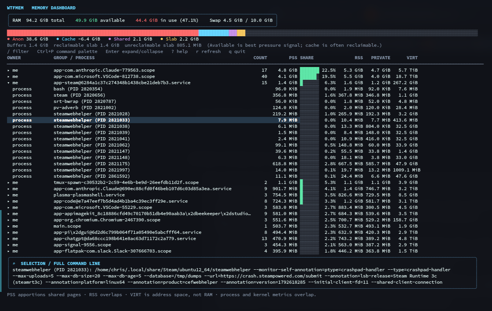

# wtfmem

A native Go TUI dashboard for understanding Linux memory use. It reads `/proc`; no elevated privileges are required, though process details unavailable to your user will be skipped.



## Build and run

Requires Linux and Go 1.26 or newer.

Build from source:

```sh
go build -o wtfmem .
./wtfmem
```

Or run directly without keeping a binary:

```sh
go run .
```

Prebuilt Linux amd64 and arm64 binaries are published as GitHub Release assets when a version tag is pushed. Download and extract the archive for your architecture, then run `./wtfmem`.

## Usage

- **↑ / ↓** or **j / k** — navigate rows
- **Enter** — expand or collapse a process group
- **/** — search/filter processes, services, or owners; **Esc** clears or closes
- **Ctrl+P** — open the command palette
- **?** — show keyboard help
- **r** — refresh immediately
- **q** — quit

Select an expanded process row to see its full command line in the details pane.

PSS apportions shared pages; RSS overlaps. VIRT is address space, not physical RAM. Kernel memory categories and process metrics overlap, so don't add them together. GPU memory may not be reported.

## Releases

GitHub Actions tests and builds on pushes and pull requests. Push a version tag to publish a release with Linux amd64 and arm64 binaries, archives, and checksums:

```sh
git tag v0.1.0
git push origin v0.1.0
```

## AI authorship

This project was written with AI assistance by OpenAI Codex using **GPT-6 Luna**. It has not necessarily been thoroughly reviewed or security-audited by a human.

## Caveat emptor

This software is provided for informational purposes and may contain bugs, incorrect assumptions, or incomplete memory accounting. Linux memory counters have caveats; process visibility depends on permissions; GPU memory may not be included. Verify important findings independently. Use at your own risk. See the MIT license for warranty and liability terms.

## License

MIT; see [LICENSE](LICENSE).
